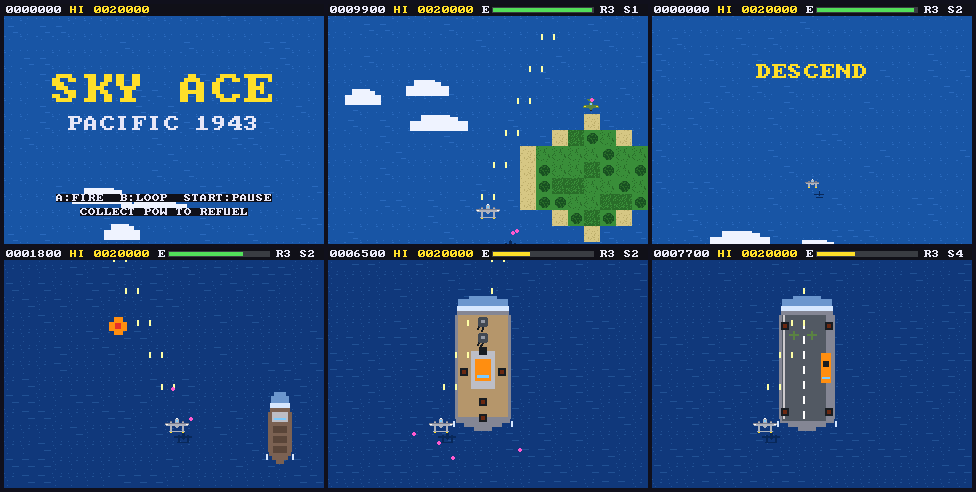

# SKY ACE



RP2040 復古掌機的直向捲軸空戰射擊，玩法致敬 1943：能量條會隨時間消耗、
被打中扣能量、吃 POW 補給，B 鍵翻滾閃避。用 [rp2040-retro-sdk](https://github.com/pondahai/rp2040-retro-sdk) 開發（`sdk/` submodule）。

| 按鍵 | 作用 |
| :--- | :--- |
| 方向鍵 | 移動 |
| A（按住） | 連射 |
| B | 翻滾（無敵，每關 3 次） |
| START | 暫停 |

- 一般敵機成波出現；紅色 5 機編隊全滅掉道具（POW 補能量 / 3WY 三向射擊）
- 轟炸機耐打、會齊射，擊落必掉道具
- 約 50 秒後魔王重轟炸機出場，擊落過關，剩餘能量換分數

## 生態系

SKY ACE 是 [rp2040-retro-handheld](https://github.com/pondahai/rp2040-retro-handheld) 生態系裡的一款遊戲。那個生態系的想法是：**同一塊硬體（RP2040 + ILI9341 320×240 螢幕 + 8 顆按鍵），燒不同的 `.uf2` 就變成不同的機器**，例如 Doom、NES 模擬器、Apple II、電子字典、SDR 收音機、USB 鍵盤。

跟這款遊戲有關的幾個 repo：

| Repo | 角色 |
| :--- | :--- |
| [rp2040-retro-handheld](https://github.com/pondahai/rp2040-retro-handheld) | 總綱：硬體 BOM、接線、所有韌體一覽 |
| [rp2040-retro-sdk](https://github.com/pondahai/rp2040-retro-sdk) | 本遊戲用的 SDK：顯示 DMA、按鍵、音效、分條 2D 繪圖、新 APP 範本 |
| [rp2040-retro-loader](https://github.com/pondahai/rp2040-retro-loader) | 開機選單，從 SD 卡挑遊戲／韌體執行（release 的 `skyace.uf2` + `SKYACE.RAW` 就是給它用的） |
| [rp2040-retro-sdmount](https://github.com/pondahai/rp2040-retro-sdmount) | 不拔 SD 卡，從電腦把檔案推進掌機（`skyace_run` 靠它） |

想自己做一款遊戲，從 SDK 的 [GETTING-STARTED](https://github.com/pondahai/rp2040-retro-sdk/blob/main/docs/GETTING-STARTED.md) 開始；SKY ACE 就是照那份文件做出來的。

## 建置

```bash
git clone --recursive https://github.com/pondahai/rp2040-skyace
source sdk/tools/env.sh
sh pc/build.sh && build_pc/preview out.png A96      # PC 預覽（按鍵序列見 pc/preview.c）
cmake -S . -B build_offset -G Ninja -DLOADER_OFFSET_BUILD=ON
ninja -C build_offset skyace_run                    # 編譯、推上掌機、啟動
```
